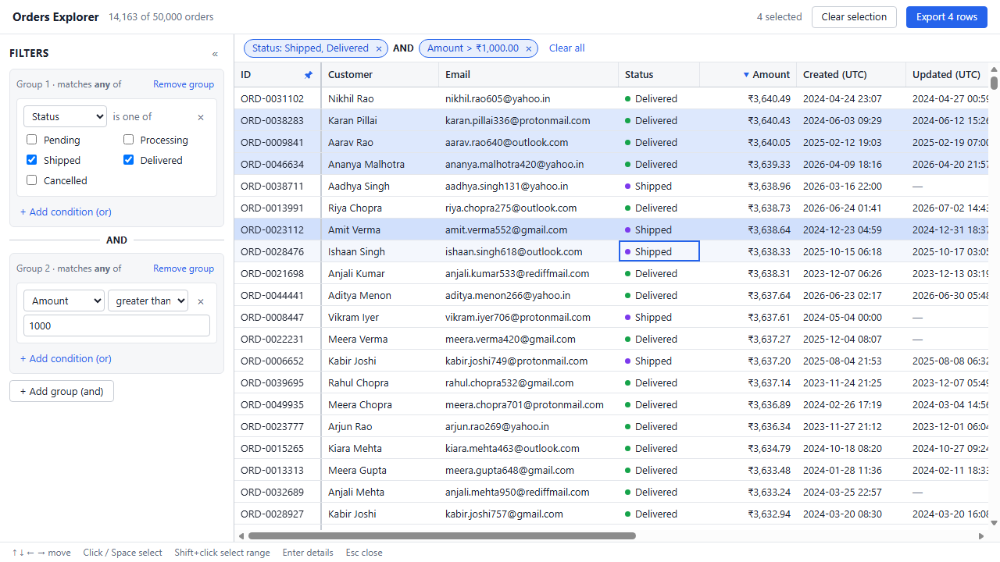
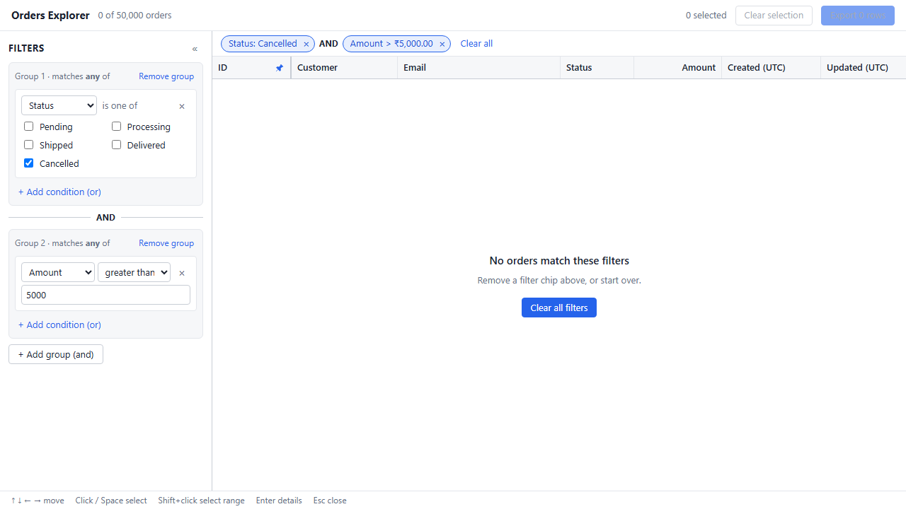
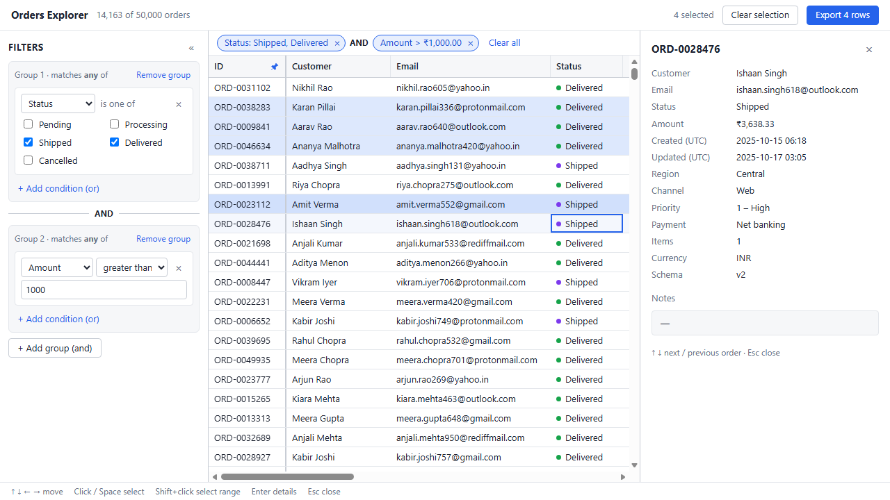
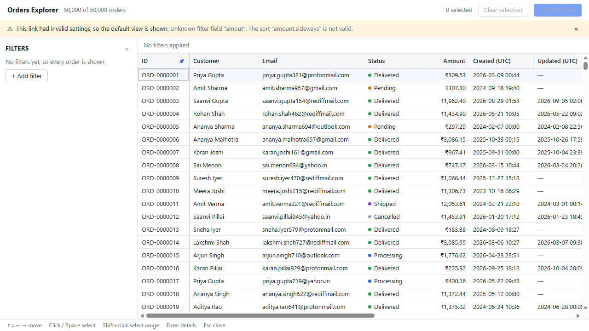

# Orders Explorer

An internal tool for an operations team: one screen with a data grid of 50,000 orders and a filter builder that controls what the grid shows. Built for 13" laptops and keyboard use.

## Tech stack

- **React 19 + TypeScript + Vite**
- **Plain CSS Modules** with CSS variables for colours and spacing
- **Node 24**, npm
- **Vitest** for unit tests

The grid, virtualization, filter builder, URL state and CSV export are written by hand, with no libraries for them.

## 1. How to run

Requires **Node 24** (see `.nvmrc`) and npm.

```bash
git clone https://github.com/bhuvan-ok/order_explorer.git
cd order_explorer
npm install
npm run dev
```

Then open http://localhost:5173.

Other commands:

- `npm test`: unit tests
- `npm run build`: type-check and production build
- `npm run preview`: serve the production build

## 2. Screenshots

Main screen, filtered and sorted, with a selection:



Filter matches zero orders:



Details panel, and a broken link falling back to the default view:




## 3. Dependencies

Runtime:

- `react`, `react-dom`: the UI library required by the stack.

Development only, not shipped to the browser:

- `vite`, `@vitejs/plugin-react`: dev server and build
- `typescript`, `@types/*`: type checking
- `vitest`: unit tests
- `oxlint`: linting (the Vite template default)
- `prettier`: formatting

## 4. Data loading

- `orders.json` is kept unchanged in `public/` and fetched by the browser when the app starts. A loading message shows meanwhile.
- **Why not import it into the code:** that would put 17 MB inside the JavaScript bundle, so nothing would appear until all of it downloaded. Fetching it separately lets the page show at once, and the file is cached on its own.
- The data is cleaned **once**, in one place (`src/data/normalize.ts`), before the grid or filter see it. Every rule in `data-notes.md` is handled there and covered by tests.

## 5. The 200 rows question

**Choice: selected rows stay selected when a filter hides them, but only the selected rows you can see are counted and exported.**

- Example: with 200 selected and 180 hidden by a filter, the toolbar shows "20 selected · 180 hidden by filter", the button says "Export 20 rows", and the CSV has 20 rows.
- When the filter is cleared, all 200 are selected again.
- **Why:**
  - **What you see is what you export:** no rows the user cannot see end up in the file.
  - **No lost work:** a quick filter doesn't wipe a hand-picked selection.
  - **The count always matches the export:** both come from the same list.

## 6. Design changes

The sketches are in [`design/`](design/). Changes made while building:

- **No checkbox column.** Selected rows are highlighted and counted instead, and click or Space toggles a row.
- **The empty state's "Clear all filters" button doesn't grab focus,** because the user is usually still typing in a filter.
- **The pin button appears when hovering a column header,** so header labels aren't cut short.
- **The toolbar also shows how many selected rows a filter is hiding.**

## Key decisions

- **Virtual scrolling.** Every row is 28 px tall, so the grid works out from the scroll position which rows are on screen. It renders only those (about 30) plus a few extra, and a tall empty spacer keeps the scrollbar the right size.
- **Sticky header and pinned column.** Both use CSS `position: sticky` inside one scroll container, so they stay lined up without extra code. The pinned column is moved to the first position.
- **Filters.** They sit in a left sidebar, so the grid stays visible while filtering. The filter is groups of conditions: OR inside a group, AND between groups. Each change turns it into a single check function that runs once per row.
- **Smooth typing.** The input updates at once. The filtering runs right after it, using React's `useDeferredValue`. Rows are sorted first and then filtered, so changing a filter never re-sorts.
- **Keyboard.** Focus stays on the grid itself, and the focused cell is tracked in state. Focus therefore isn't lost when rows scroll out of view and are removed.
- **Selection.** It is stored as a set of order IDs, so it survives sorting and filtering. Click and Space toggle a row, and Shift+click selects a range.
- **URL.** Filter, sort, pinned column and selection are written to the URL. When the page opens, the URL is read and checked; if anything is invalid, a message shows and the default view opens instead of crashing.
- **Details panel.** It opens beside the grid instead of over it, and follows the focused row (↑ ↓).
- **Dates.** They are shown and filtered in UTC, so everyone opening the same link sees the same results.

## 7. Known issues

- **Column resize** works with the mouse only, and widths reset on reload.
- **Selection:** range selection is Shift+click only, there is no "select all", and double-clicking a row to open details also toggles its selection on and back off.
- **Long URLs:** large, scattered selections make the URL long.
- **Layout:** made for laptop screens, with no mobile layout. With both side panels open the grid gets narrow; the filter panel can be collapsed.
- **Browsers:** tested in Chrome/Edge only.

## Project structure

```
src/
  data/            load and clean orders.json
  fields/          the 13 columns: label, type, width, formatting
  grid/            grid, virtual scrolling, sorting, selection, keyboard
  filter/          filter logic and chip text
  filter-builder/  filter sidebar and chips
  details/         order details panel
  url/             saving the view in the URL
  export/          CSV export
  components/      small shared pieces
```
